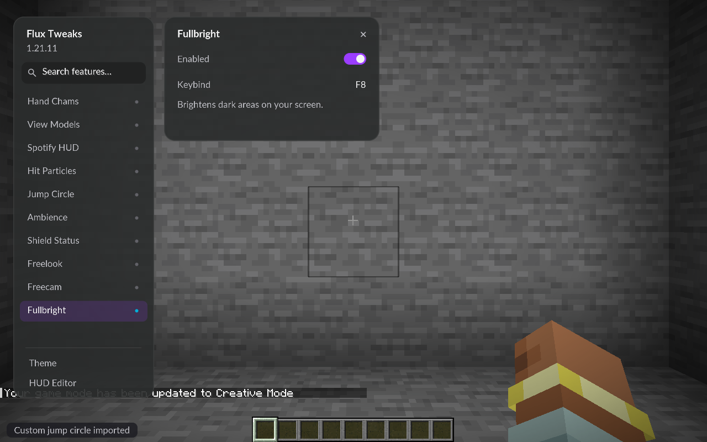

# Fullbright — Flux Tweaks 0.1.2

## Use

Replace the previous Flux Tweaks JAR with **fluxtweaks-0.1.2.jar**. In a world, open **Right Shift → Fullbright** and turn on Enabled. Assign a keybind in the feature panel or Minecraft Controls if desired. Fullbright starts disabled and unbound on a new or older configuration; its state and binding are then saved.

## Behavior

Fullbright brightens the client lightmap for blocks and entities. It preserves Minecraft's brightness option, adds no Night Vision potion, and changes no server light levels, mob spawning, time or weather. Disabling it forces an immediate lightmap refresh to restore normal lighting. No new dependency or resource pack is required. The existing GUI refinement and original nine modules remain included.

## Checks completed 2026-10-21

- Java 21 production build and all 12 focused JUnit checks passed.
- Configuration roundtrip preserves Fullbright enabled state; migration from a config without the module adds it disabled and retains other modules.
- Packaged Fabric and Fabric + Sodium 0.8.14 game checks both passed in disposable single-player worlds, including the existing GUI/effects/camera checks.
- A fully enclosed stone room at zero sky light was captured with Fullbright off, on, then off again. An assigned F8 test binding toggled it both ways; gamma remained zero and no Night Vision effect was added. F8 is an isolated test assignment, not the shipping default.
- Mean luminance of the same central wall patch (0–255 scale):

| Renderer | Off | On | Restored |
| --- | ---: | ---: | ---: |
| Fabric | 6.5878 | 98.5855 | 6.5878 |
| Sodium | 6.6010 | 98.6719 | 6.6010 |

The sampled patch returned to its original value in both runs. These are visibility/restoration checks, not GPU performance measurements.

[Off capture](acceptance/fullbright-off-0.1.2.png) · [On capture](acceptance/fullbright-on-0.1.2.png) · [Restored capture](acceptance/fullbright-restored-0.1.2.png)

## Pending

User confirmation in the normal gameplay profile, multiplayer at the user's request, and Iris/shader-pack compatibility. Prior acceptance limits for Spotify, remote shield estimates and stress/performance checks remain recorded in CHECKLIST.md.

## Follow-up 2026-10-21

The owner subsequently confirmed that everything also works in multiplayer. This supersedes the general user-confirmation/multiplayer item above. Automated dedicated-server checks remain disabled, and the detailed acceptance limits in CHECKLIST.md still apply.
