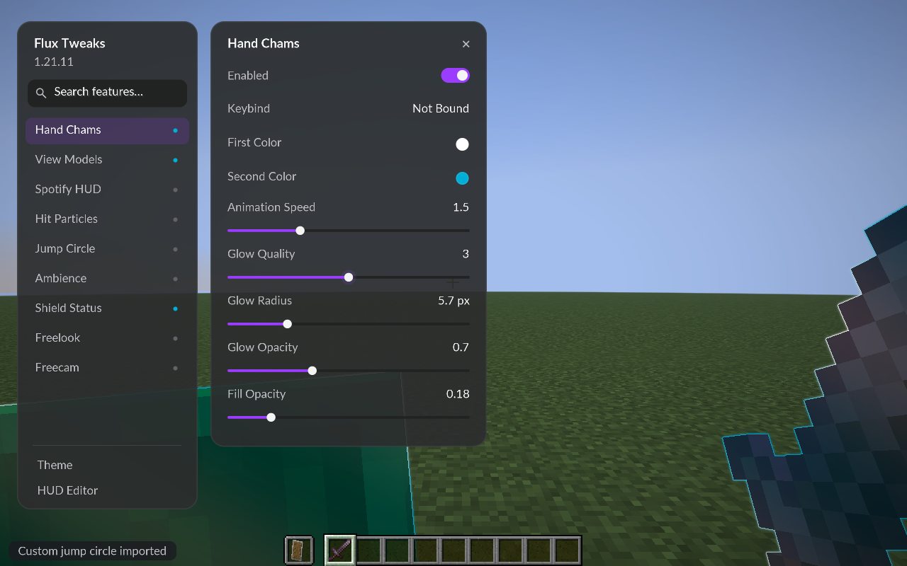

# GUI refinement - Flux Tweaks 0.1.1

2026-10-21. The user reported that all nine features work, then requested smoother text and controls and approved refinement of layout and spacing.

## What changed

- Flux's Lato regular and bold faces use linear texture sampling and alpha coverage that preserves faint glyph edges. Search and numeric/hex fields use matching font metrics and styling. Normal Minecraft text continues through its own font styles.
- Panels, circles, switch thumbs, slider tracks and knobs, focus borders and icons use an analytic anti-aliasing shader. Curves are evaluated at the displayed size with pixel derivatives rather than enlarged low-resolution corner pictures. The old corner-mask assets and their generator were removed.
- The two-panel layout uses more compact proportions, consistent padding and real heading weights. The full nine-feature list fits at the checked sizes. Settings cards shrink for short feature lists and scroll longer ones.
- Toggle thumbs/colours, hover feedback, typed slider-value changes and settings scrolling ease over time. Dragging a slider follows the pointer directly.
- The colour picker uses continuous saturation/value and hue gradients. Its thin hue strip is normalized independently on each axis; a captured-image check asserts that green and blue remain present across its full height.
- Search, close, selection checks and playback triangles use clean geometric shapes.

Configuration schema remains version 1. Existing feature settings and saved layout positions are retained. Use Reset Layout in Theme (or Home) if you want the default placement with the new proportions.

## Install

Replace `fluxtweaks-0.1.0.jar` in your Fabric 1.21.11 profile's mods folder with `fluxtweaks-0.1.1.jar`. Continue using Fabric API and Java 21. Right Shift opens the menu.

## Preview



[Colour picker](acceptance/flux-color-picker-0.1.1.png) · [Choice list](acceptance/flux-choices-0.1.1.png)

## Validation

**Passed:** eleven logic checks, the packaged Fabric run and the packaged Fabric + Sodium run, including the hue-strip pixel assertion.

The final production-game checks run the remapped installable JAR, plus the separate acceptance-test mod, on Java 21 with Fabric alone and Fabric + Sodium 0.8.14. They exercise GUI binding/clearing, typed slider values, hex input, search, dragging/reset and resize recovery, alongside the existing combined-feature smoke checks.

Captured resolutions/scales: 854x480 at Minecraft GUI scale 1, 1280x800 at scale 2, and 1920x1080 at scale 3. Visual review includes the in-world GUI, long choice lists, a compact settings card and the colour popup. The hue-strip pixel check guards its full gradient range. Eleven existing logic checks cover configuration, time and shield logic.

Commands:

```powershell
.\gradlew.bat build runProductionClientGameTest --console plain
.\gradlew.bat build runProductionClientGameTest -PsodiumAcceptance --console plain
```

Evidence logs: ignored `work/gui-fabric-final.log` and `work/gui-sodium-final.log`. Captures: `build/run/productionFabric/screenshots` and `build/run/productionSodium/screenshots`. Selected screenshots are copied to `docs/acceptance/`.

No multiplayer test server was started and no EULA acceptance was set. Multiplayer acceptance remains pending at the user's request. See [the first-release acceptance record](ACCEPTANCE.md) and [the checklist](../CHECKLIST.md) for broader outstanding checks. Dedicated GPU frame-time/performance measurements and personal approval of the new visual proportions remain open.

## Maintenance

- `gui/SmoothGui.java` and `shaders/core/ui_shape.*`: native batched anti-aliased geometry and picker gradients.
- `mixin/UiGlyphMixin.java` and `shaders/core/ui_text.*`: filtering/coverage scoped to Flux font resource styles.
- `mixin/FontAccess.java`, `gui/Ui.java`: correctly measured editable text, shared controls, icons and easing.
- `gui/FluxScreen.java`: responsive sizing, adaptive card height, spacing and feedback.
- `gametest/.../GuiAcceptance.java`: existing input checks plus picker-colour capture assertion and scale/choice snapshots.

The glyph sampling behavior was confirmed in the 1.21.11 game sources; [Fabric's 1.21.11 GUI documentation](https://docs.fabricmc.net/1.21.11/develop/rendering/gui-graphics) was retrieved through Context7. Rendering uses the existing Fabric/Minecraft pipeline without an extra UI library. Lato Bold shares the bundled SIL Open Font License.
