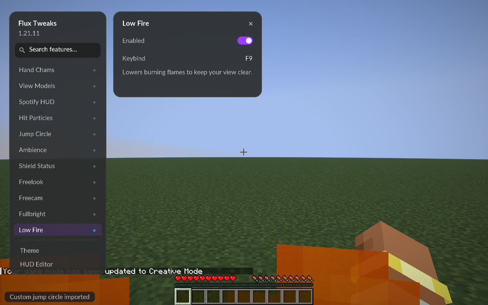

# Low Fire — Flux Tweaks 0.1.3

## Use

Replace the previous Flux Tweaks JAR with **fluxtweaks-0.1.3.jar**. In a world, open **Right Shift → Low Fire** and enable it. Assign a keybind in the module or Minecraft Controls if desired. It starts disabled and unbound; enabled state and bindings are then saved. Existing configurations remain compatible.

## Behavior

Lowers the original first-person flame overlay toward the bottom of the screen. The fire animation and original texture remain, leaving a reduced burning indicator. Disabling it immediately returns the overlay to vanilla height.

Only the vertical translation inside vanilla's fire-overlay rendering changes. World fire, other entities' flames, player fire ticks, damage and sounds retain their game behavior. There are no extra dependencies or resource packs. Fullbright and the original nine features remain included.

## Acceptance

- Java 21 build/remap and all 13 focused JUnit checks passed.
- Older configurations add Low Fire disabled without losing existing features. Enabled state survives configuration reload; initial bindings remain unbound through the shared registry.
- Packaged single-player checks passed with Fabric alone and Fabric + Sodium 0.8.14, including the existing GUI, Fullbright, camera and visual smoke checks.
- An F9 test binding enabled/disabled Low Fire while the player remained on fire on the integrated server. Normal overlay height returned after disabling. F9 is an isolated test binding, not the shipping default.
- Screenshot checks sampled multiple animation frames, verified that the upper view cleared and that flames remained visible along the bottom. Sampling excludes the held arm and counts orange fire pixels in the left third of the upper 65% of the screen:

| Renderer | Normal | Low Fire | Restored |
| --- | ---: | ---: | ---: |
| Fabric | 92224 | 0 | 92224 |
| Sodium | 81289 | 0 | 81289 |

These are visibility/restoration checks, not performance measurements. Fire animations vary between captures, so normal and restored counts need not match.

[Normal flames](acceptance/low-fire-off-0.1.3.png) · [Low Fire enabled](acceptance/low-fire-on-0.1.3.png) · [Vanilla height restored](acceptance/low-fire-restored-0.1.3.png)

## Multiplayer and remaining checks

On 2026-10-21 the owner confirmed that all existing features also work in multiplayer. This records their gameplay confirmation for the previous 0.1.2 build. Low Fire is a new module and still needs their confirmation in the normal multiplayer profile. Automated dedicated-server testing/EULA acceptance remain disabled as previously requested. Iris/shader packs, custom fire resource packs and a full FOV/aspect-ratio matrix have not been checked.
