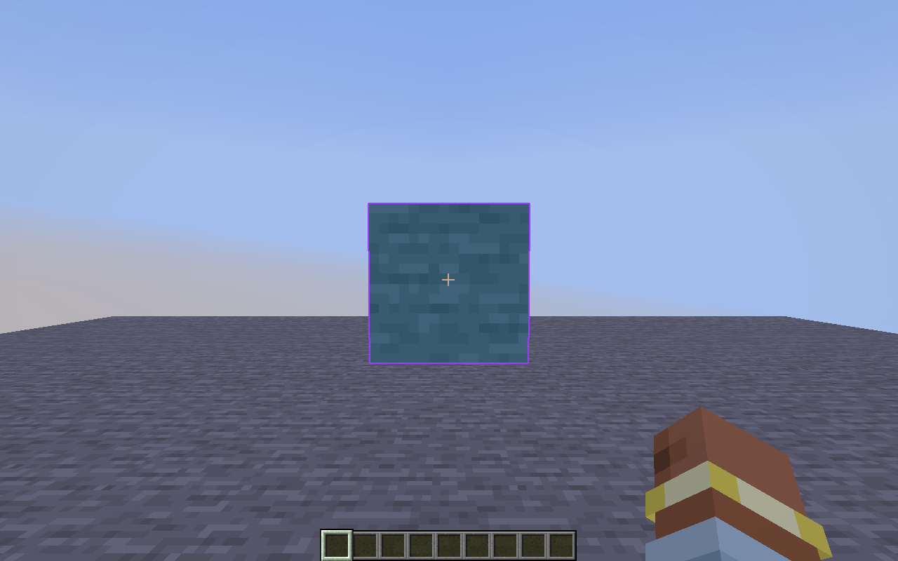
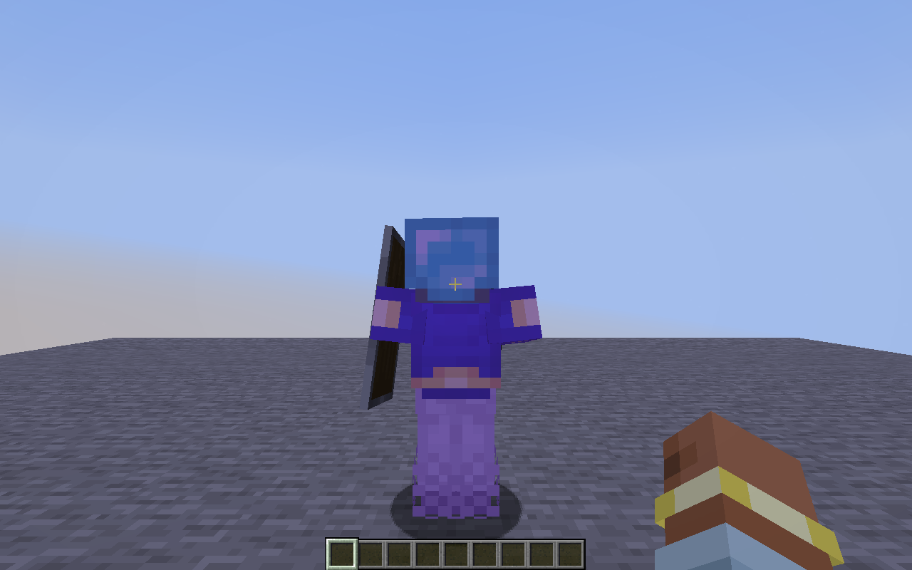

# Flux Tweaks 0.1.4 — approved module specification

## Zoom

Enabled arms the module; hold its assigned key to zoom. Scroll up/down adjusts magnification in multiplicative 1.2x steps while held, consuming hotbar scrolling. Each activation starts at the saved default (4x, adjustable 1–16x). Smooth transitions use 150 ms by default, adjustable 50–500 ms. Sensitivity scales with magnification without cinematic drift. Only world FOV changes; hands, crosshair and HUD keep their ordinary size. Compose with vanilla FOV effects and clamp final FOV to at least 1 degree. Never overwrite saved FOV or sensitivity.

Opening a screen, losing focus, death or changing worlds cancels transient zoom immediately and requires a fresh press. Enabled/configured settings persist; runtime activation and scroll adjustments do not. Compatible with Freelook and Freecam.

## Block Overlay

Highlight only the current block under the crosshair, using its real selection shape and vanilla targeting reach. Outline and fill have separate switches, colors and 0–100% opacity. Defaults: both enabled; purple #9B3DFF outline at 100%, 2 px width (1–6 px); cyan #00AFD8 fill at 20%. Use Fabric's block-outline event and depth testing. Disabling restores vanilla; enabling with both parts off hides the selection highlight. Clear on air/entity targets. No through-wall highlight or information card.

## Hit Color

Color normal hurt/death flashes regardless of damage source. Default purple #9B3DFF at 35% opacity. Separate Players/Mobs/Self switches, initially on/on/off; Self applies to your third-person model. Tint original textured bodies and worn armor, including trims; retain dye and glint. Held items, Shield Status and Hand Chams retain their existing appearance. Blocked hits without a vanilla damage flash add no flash. Preserve vanilla overlays on excluded entities. Use a separate overlay entry and cached armor variants; update resources on settings/resource changes.

## Integration and acceptance

Stable IDs: zoom, block_overlay, hit_color. All three initially disabled/unbound. Reuse GUI, search, Controls and version-1 config migration; existing settings remain. Target Minecraft 1.21.11 Fabric and Sodium with no new dependencies. Ship version 0.1.4 JAR/source, updated checklist and installation notes.

## Verified acceptance — 2026-10-21

- Java 21 production build/remap and all **18** focused JUnit checks passed. New checks cover Zoom easing/FOV/scroll limits/default reset/fresh-press cancellation and older-config migration/persistence for all three modules.
- Packaged **Fabric alone** and **Fabric + Sodium 0.8.14** game checks passed, including the earlier GUI, camera, Fullbright, Low Fire and visual regressions.
- Actual world FOV reduced while hand FOV stayed unchanged. Keyboard and mouse hold bindings, release, default reset, 1.2x scroll adjustment, hotbar isolation/restoration, unchanged saved FOV/sensitivity, GUI/focus/death cancellation, native key-state restoration/repeat rejection, Freelook/Freecam and spyglass composition were exercised.
- Block screenshots checked independent fill/outline switches, 2/6 px widths, both parts hidden and vanilla restoration. Slab, stair, fence and plant selection shapes were exercised. A test-only forced target behind a nearer solid block produced zero diagnostic highlight pixels, verifying depth occlusion.
- Native model submissions and screenshots checked a synthetic hurt mob's body, full worn armor, leather dye, enchanted armor/glint and trim. Player/Self filtering and vanilla hurt/death routing were checked through native renderer extraction. Excluded/disabled states retained vanilla overlays; held-item submissions remained outside the custom overlay. Live green/100% and zero-opacity captures checked texture updates.
- Each new module was selected through GUI search. Zoom's binding held without toggling Enabled; the other new module bindings toggled normally. Settings remained accessible in the existing scrollable layout.
- Shipping JAR inspection confirms version/client environment, Java 21 bytecode, native media bridge, font licenses and new modules, with no test mixins/probes. Source ZIP inspection confirms wrapper, all 17 original references, production/test/native sources and documentation.

Commands (Java 21):

```powershell
.\gradlew.bat build runProductionClientGameTest -PsodiumAcceptance --console plain
.\gradlew.bat runProductionClientGameTest --console plain
```


## Remaining acceptance

The owner confirmed the pre-0.1.3 modules work in multiplayer. Low Fire and the three new 0.1.4 modules still need their multiplayer confirmation; no dedicated-server EULA acceptance or test server was enabled. Real remote players/server-specific behavior and the exhaustive sustained-performance/dimension/death matrix remain outside the automated fixture checks. Player/Self routing was checked through native renderer-state extraction, and body/armor pixels were captured using a local synthetic mob. Iris/shader packs and third-party model/equipment renderers have not been checked.

## Screenshots





[Zoom before](acceptance/014-zoom-off.png) · [Zoom active](acceptance/014-zoom-on.png) · [Zoom settings](acceptance/014-settings-zoom.png) · [Block Overlay settings](acceptance/014-settings-block_overlay.png) · [Hit Color settings](acceptance/014-settings-hit_color.png)

Captures use an isolated test profile. The F10 Zoom binding is for acceptance only; shipping bindings remain unbound. Some test captures intentionally use full opacity/bright diagnostic colors; the default Block Overlay capture uses the agreed purple/cyan colors and 20% fill.
